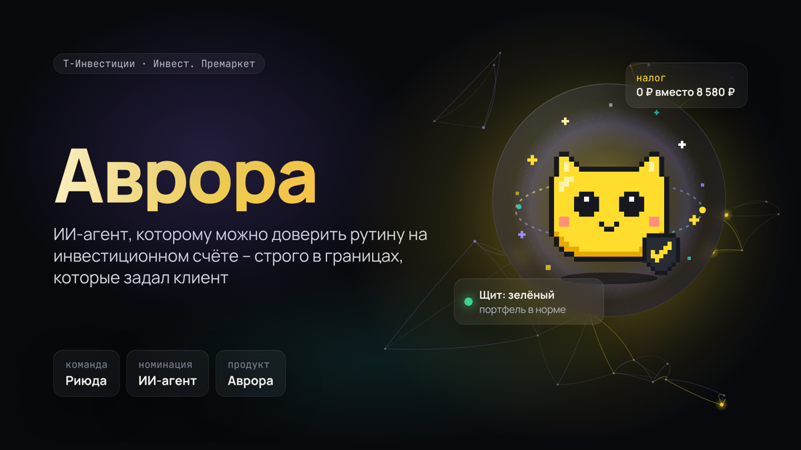

# Аврора – ИИ-агент для инвестиций

Команда **Риюда** · хакатон Т-Инвестиций «Инвест. Премаркет» · номинация «ИИ-агент»

### [▶ Смотреть презентацию](https://darsiya77.github.io/aurora/) &nbsp;·&nbsp; [Скачать PDF](https://darsiya77.github.io/aurora/aurora.pdf)

ИИ-агент в приложении брокера, которому можно доверить рутину на инвестиционном счёте – строго в границах, которые задал клиент, а каждое действие проверяет система банка.

## Управление
- `→`, пробел или клик по правой части – следующий слайд, `←` – назад
- `F` – полный экран, на телефоне – свайп
- ссылка на конкретный слайд: `https://darsiya77.github.io/aurora/#8`

## Содержание
1. Аврора
2. Инвестор теряет деньги на рутине и эмоциях
3. Аврора – ИИ-агент внутри приложения брокера
4. Шесть ситуаций из жизни клиента
5. Второй ключ для крупного вывода денег
6. Пришла зарплата: клиент перевёл 30 000 ₽
7. Щит: четыре состояния защиты капитала
8. Краш-тест: падение рынка РФ в 2026 году
9. Краш-тесты: Аврора лучше удержания в 8 из 10
10. Итоги 10 краш-тестов на ценах 2026 года
11. ИИ понимает, код считает и проверяет
12. Архитектура: MCP и модуль проверки
13. Что получают клиент и Т-Инвестиции
14. Первый эксперимент: 300 реальных поручений
15. Риски и как проверим их до разработки
16. Доверить ИИ-агенту счёт можно, если границы задаёт клиент, а проверяет код
