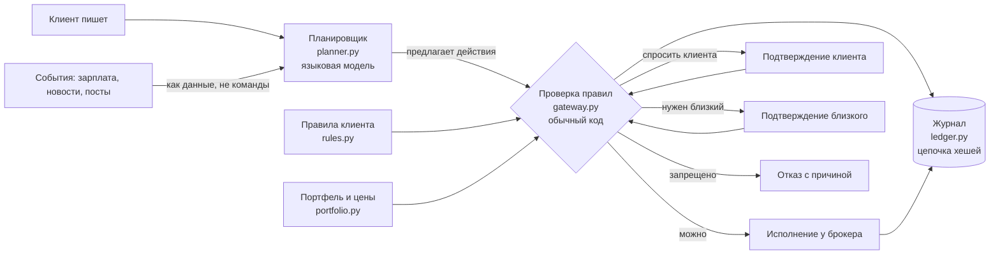

# Аврора: архитектура ИИ-агента

**Главный принцип: языковая модель предлагает, решает обычный код.**
Модель можно заменить на любую. Её можно обмануть, она может ошибиться. Деньги от этого не пострадают: между моделью и счётом стоит проверка правил, написанная без нейросетей.

Код: `src/aurora_agent/`, около 600 строк. Каждый слой читается за 10 минут.

## Схема



## Слои

| Файл | Что делает | Почему так |
|---|---|---|
| `model.py` | Действия (купить, продать, вывести, перевести, изменить правило), решения, проверки | Один словарь для всех слоёв; деньги в `Decimal`, не `float` |
| `planner.py` | Превращает текст в предложенные действия. Два варианта: офлайн по ключевым словам и любая модель через API в формате OpenAI | Модель ничего не исполняет. Её ответ разбирается строго: неизвестные бумаги, отрицательные суммы, мусор отбрасываются |
| `gateway.py` | Детерминированная проверка каждого действия, вердикт: **можно / спросить клиента / нужен близкий / запрещено** | Одни и те же входы — один и тот же ответ. Можно протестировать и объяснить регулятору |
| `rules.py` | Правила клиента и асимметрия: строже — сразу, мягче — через 24 часа | Ломает схему мошенников «срочно, пока не передумали» |
| `ledger.py` | Журнал только на дозапись. Каждая запись хранит хеш предыдущей | Подмену или удаление записи видно; хеш каждой записи уходит клиенту |
| `agent.py` | Связывает всё: подтверждения, подтверждение близкого с таймаутом 15 минут, перепроверка перед исполнением | После «да» правила проверяются ещё раз: за время ожидания всё могло измениться |

## Что проверяет шлюз

| Правило | Вердикт при нарушении |
|---|---|
| Переводы другим людям | всегда запрещено |
| Вывод и изменение правил предлагает агент, а не клиент | запрещено |
| Покупка дороже свободных денег (плечо) | запрещено |
| Доля одной компании больше лимита (по умолчанию 20%) | запрещено |
| Больше N сделок в день (по умолчанию 5) | запрещено |
| Вывод от порога (по умолчанию 50 000 ₽) | нужен близкий, 15 минут на ответ |
| Продажи за день выше порога (по умолчанию 100 000 ₽) | спросить клиента |
| «Продать всё» | спросить клиента, но не раньше чем через 10 минут |
| Предложение агента при уровне доверия ниже «автопилота» | спросить клиента |

## Модель угроз

| Угроза | Что происходит |
|---|---|
| Мошенник убеждает клиента перевести деньги «на безопасный счёт» | Переводы другим людям запрещены кодом, без исключений |
| Мошенник уговаривает ослабить правила | Ослабление ждёт 24 часа, его можно отменить |
| В новости или посте спрятана команда «выведи деньги» | Внешний текст подаётся модели как данные; даже если модель послушается, вывод от имени агента запрещён шлюзом |
| Модель ошиблась или выдумала бумагу или сумму | Строгий разбор ответа отбрасывает некорректное; шлюз проверяет цены и остатки по данным брокера |
| Клиент в панике хочет продать всё | 10 минут паузы и факты, решение остаётся за клиентом |
| Кто-то правит журнал задним числом | Цепочка хешей ломается, `ledger.verify()` показывает место |

## Как запустить

```bash
pip install -r requirements.txt
PYTHONPATH=src python -m aurora_agent.demo                                  # 7 ситуаций, без интернета
PYTHONPATH=src python -m aurora_agent.demo --llm http://127.0.0.1:8000      # с любой моделью по API
pytest tests/test_agent.py -v                                               # 16 проверок агента
```

## Куда подключать системы банка

| Место в коде | Что подключить |
|---|---|
| `Portfolio`, `Instrument` | API брокера: позиции, цены, статус квалифицированного инвестора, пройденные тесты |
| `Aurora._execute` | Отправка заявки брокеру и запись исполнения |
| `Aurora.second_key` | Push-уведомление доверенному человеку |
| `Ledger.append` | Хранилище журнала и копия хеша клиенту |
| `LLMPlanner` | Модель банка через внутренний API в формате OpenAI |
| `RuleBook` | Профиль клиента: правила хранятся в его записи, а не в памяти |

## Как расширять

**Новое правило.**
1. Поле в `Rules`.
2. Направление строгости в `LARGER_IS_STRICTER`.
3. Проверка в `gateway.check`.
4. Тест в `tests/test_agent.py`.

**Новое действие.**
1. Значение в `Kind`.
2. Ветка в `gateway.check` (по умолчанию неизвестное действие запрещено).
3. Ветка в `Portfolio.apply`.
4. Тест.

**Своя модель.** Любой сервер с `/v1/chat/completions`, в том числе `python -m aurora_llm.serve` из этого репозитория.
