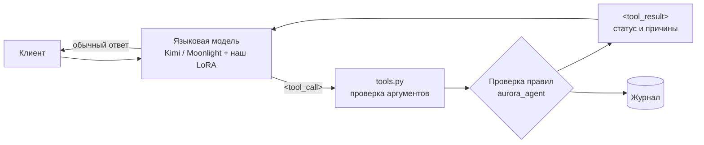

# Ассистент Авроры: модель, которая отвечает и действует

Пакет `src/aurora_assistant/`. Берёт открытую чат-модель, учит её вызывать инструменты Авроры и пропускает каждый вызов через проверку правил из `aurora_agent`.

## Как это устроено



1. Модель отвечает текстом или вызывает инструмент строкой `<tool_call>{"name": ..., "arguments": {...}}</tool_call>`.
2. `tools.py` проверяет аргументы (бумага существует, количество целое и положительное) и превращает вызов в действие.
3. Проверка правил решает: можно, спросить клиента, нужен близкий, запрещено. Модель на это решение не влияет.
4. Результат возвращается модели, она объясняет его клиенту человеческим языком.

## Какая модель

| Модель | Параметры | Лицензия | Железо для дообучения | Роль |
|---|---|---|---|---|
| **Moonlight-16B-A3B-Instruct** (Moonshot AI, семейство Kimi) | 16 млрд, 3 млрд активных | MIT | 1 × H100 80 ГБ | основная модель для дообучения |
| Kimi-Linear-48B-A3B-Instruct | 48 млрд, 3 млрд активных | MIT | 2 × H100 80 ГБ | вариант покрупнее |
| Kimi-K2.6 / K3 | 1 / 2,8 трлн | Modified MIT / своя | кластер | без дообучения, через API: формат вызовов тот же |
| Qwen2.5-0.5B-Instruct | 0,5 млрд | Apache 2.0 | процессор | только проверка кода |

Лицензии больших Kimi требуют показывать название модели в интерфейсе при большой аудитории или выручке. Для продукта банка это нужно согласовать с юристами.

## Почему адаптеры только на части слоёв

Moonlight и Kimi-Linear — смеси экспертов: в каждом слое десятки и сотни «экспертов», на каждый токен работают несколько. Адаптеры LoRA ставятся на внимание, общих экспертов и плотные слои (`target_modules` в конфиге). Маршрутизируемые эксперты заморожены: иначе адаптер вырос бы в десятки раз, а знания экспертов размылись бы. Конфиг проверен на уменьшенной копии архитектуры Moonlight: адаптеры встают на 21 слой из 57, прямой и обратный проход работают.

## Файлы

| Файл | Что внутри |
|---|---|
| `tools.py` | Список инструментов, проверка аргументов, вызов ядра агента |
| `format.py` | Системный промпт, формат вызовов, разбор ответа модели, маска потерь |
| `data.py` | Обучающие диалоги: действия, ответы, отказы, мошенничество, общие вопросы. Результаты инструментов — из настоящего ядра агента |
| `train.py` | Цикл дообучения LoRA на чистом PyTorch: батчи, накопление градиентов, расписание шага, оценка, сохранение |
| `evaluate.py` | Точность вызова инструментов на отложенных диалогах с новыми формулировками |
| `assistant.py` | Рабочий цикл: модель → инструмент → правила → ответ. Локальная модель или любая по API |
| `serve.py`, `web/chat.html` | Веб-чат: разговор, ход действий, состояние счёта, исправление ответов для дообучения |
| `merge.py` | Вклеивает адаптер в модель для быстрой работы на сервере |

## Команды

```bash
pip install -r requirements.txt -r requirements-assistant.txt
export PYTHONPATH=src

python -m aurora_assistant.data --out data/assistant                       # диалоги
python -m aurora_assistant.evaluate --base Qwen/Qwen2.5-0.5B-Instruct      # точность до обучения
python -m aurora_assistant.train --config configs/assistant/tiny-qwen.yaml # дообучение
python -m aurora_assistant.evaluate --base Qwen/Qwen2.5-0.5B-Instruct --adapter runs/assistant-tiny-qwen/adapter
python -m aurora_assistant.serve --base Qwen/Qwen2.5-0.5B-Instruct --adapter runs/assistant-tiny-qwen/adapter
# откройте http://127.0.0.1:8080
```

На арендованной видеокарте всё делает `bash scripts/assistant_gpu.sh`.

Чат с любой моделью по API в формате OpenAI, например с большой Kimi или с нашей моделью на сервере vLLM:

```bash
python -m aurora_assistant.serve --api https://адрес-сервера/v1 --model имя-модели --key $AURORA_API_KEY
```

## Как учить модель через чат

1. В чате под любым ответом нажмите «Исправить ответ» и напишите, как должна была ответить Аврора.
2. Диалог с исправлением сохраняется в `data/assistant/feedback.jsonl`.
3. Следующий запуск `train.py` добавляет эти примеры к обучающим (`extra_train_files` в конфиге).

Контекст проекта (`docs/AURORA_CONTEXT.md`) модель получает, когда спрашивают о самой Авроре. Для запросов по счёту промпт остаётся тем же, что при обучении, чтобы маленькие модели не путались.

## Как добавить инструмент

1. Описание в `TOOLS` в `tools.py`.
2. Ветка в `to_action` или в `execute`.
3. Шаблоны фраз в `INTENTS` в `data.py`: обучающие и отдельные для оценки.
4. Тест в `tests/test_assistant.py`.
5. Новый запуск `data.py` и `train.py`.
